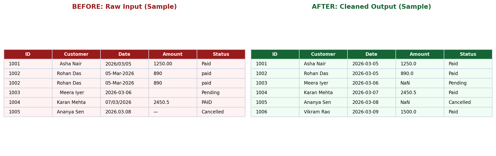

# Deterministic Data Cleaning & Validation Pipeline (Python & SQL)

A reproducible, rule-based data cleaning workflow that transforms messy CSV/tabular exports into standardized, analysis-ready datasets with full row-level audit logs and visual validation summaries.

## What This Pipeline Solves

Raw business exports frequently break downstream reports due to silent structural issues. This pipeline enforces deterministic rules without black-box guesswork:

- **Deduplication:** Identifies and removes exact duplicate records on key business fields while logging removed counts.
- **Date & Format Standardization:** Parses mixed date representations (`YYYY/MM/DD`, `DD-Mon-YYYY`, `DD/MM/YYYY`, `YYYY.MM.DD`) into strict ISO `YYYY-MM-DD` format.
- **Text & Encoding Normalization:** Trims stray whitespace, standardizes casing, and cleans encoding artifacts.
- **Numeric & Null Validation:** Converts non-numeric placeholders (`N/A`, `-`, `—`, blanks) into explicit nulls and flags anomalies (such as negative amounts or malformed fields) for review.

---

## Project Structure

```text
├── 01_raw/
│   └── messy_orders.csv              # Sample raw input dataset
├── 02_scripts/
│   ├── clean_orders.py               # Deterministic Pandas cleaning & validation script
│   └── clean_orders_sqlite.sql       # Standard SQLite equivalent
├── 03_cleaned/
│   ├── clean_orders.csv              # Standardized output dataset
│   ├── quarantined_rows.csv          # Flagged rows isolated for review
│   └── before_after.png        # Matplotlib audit summary chart
└── README.md
```
##Quick Start
###1. Run the Python Pipeline
```Bash
python 02_scripts/clean_orders.py
```
###2. Requirements
* Python 3.10+

* pandas

* matplotlib

Install dependencies if needed:

```Bash
pip install pandas matplotlib
```
##Sample Validation & Audit Log
Running the pipeline on 01_raw/messy_orders.csv produces a deterministic reconciliation report:
```text
Plaintext
=== VALIDATION SUMMARY ===
Input rows:          10
Duplicates removed:  1
Output rows:         9
Null amounts (NaN):  2
Negative amounts:    1
Invalid dates:       0
```
##Visual Summary
(Optional: Add your Before vs. After comparison image here as )

##Design Principles
* Reproducible: Running the script twice on the same input always yields the exact same output.

* Auditable: Every dropped duplicate, null conversion, and flagged anomaly is counted and reconciled against input row counts.

* Transparent: Clear, readable Python and SQL logic with zero hidden side effects.


